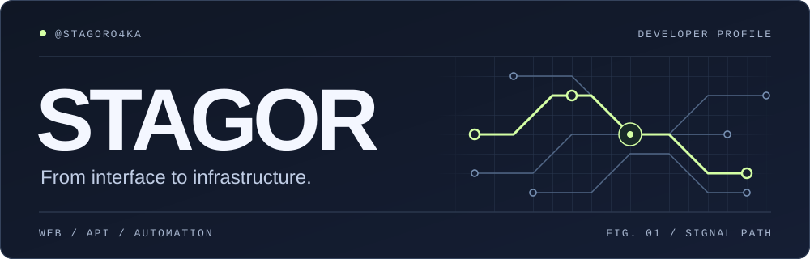

<picture>
  <source media="(max-width: 600px)" srcset="./assets/stagor-banner-mobile.svg">
  
</picture>

I build web products, APIs, and Telegram bots. I like working on both sides of the interface: what someone clicks, and what has to happen next.

## What I build

**01 / Web products** — Interfaces for customers and the tools that run them: storefronts, checkout flows, and admin dashboards.

**02 / Bots & integrations** — Telegram workflows, APIs, and payment integrations that connect products to other services.

**03 / Backend & operations** — Queues, retries, and deployment. The parts that matter when a request fails halfway through.

---

**Stack** · TypeScript / React / Next.js · Node.js / Python / Go · MongoDB / Redis / Linux
